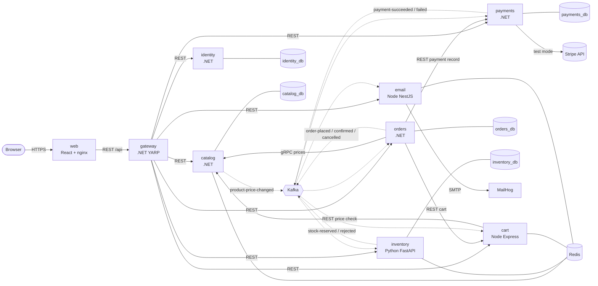

# Architecture

shop-stream is eight backend services plus a React app. Every request from the browser enters through
one gateway; services talk to each other synchronously only where an answer is needed *now* (prices,
the cart, a payment record), and everything else - the whole checkout - flows as events over Kafka.

## System diagram

Solid arrows are synchronous calls (REST or gRPC). Dotted arrows are asynchronous Kafka events.

Every container writes structured JSON logs to stdout; Promtail ships them to Loki and Grafana
queries them (not drawn above to keep it readable - see [deployment.md](deployment.md#docker-compose)).

## Services

| Service | Language | Port (host / container) | Store | Responsibility |
|---|---|---|---|---|
| `web` | React 18 + nginx | 3000 / 80 | - | Storefront and admin UI; nginx proxies `/api` to the gateway |
| `gateway` | .NET 7 (YARP) | 5000 / 8080 | - | Single entry point: routing, JWT validation, rate limiting, aggregated Swagger |
| `identity` | .NET 7 | 5001 / 8080 | PostgreSQL `identity_db` | Users, roles, JWT access tokens, rotating refresh tokens |
| `catalog` | .NET 7 | 5002 / 8080, gRPC 5012 / 8081 | PostgreSQL `catalog_db`, Redis (cache) | Categories, products, search; gRPC server for prices |
| `orders` | .NET 7 | 5003 / 8080 | PostgreSQL `orders_db` | Order lifecycle and saga state, outbox, order-details composition, admin reports |
| `payments` | .NET 7 | 5004 / 8080 | PostgreSQL `payments_db` | Stripe test mode or mock, payment records, outbox |
| `inventory` | Python 3.11 (FastAPI) | 8001 / 8000 | PostgreSQL `inventory_db`, Redis (cache) | Stock levels, reservations with expiry |
| `cart` | Node 18 (Express) | 3001 / 3000 | Redis | Per-user carts |
| `email` | Node 18 (NestJS) | 3002 / 3000 | Redis (inbox only) | Notification emails via SMTP (MailHog locally) |

Host ports other than 3000 and 5000 are only published by `deploy/docker-compose.override.yml`.

## Data ownership

Each service owns its data and nobody else reads it - there are no shared tables and no cross-database
queries. When a service needs another service's data it either asks for it (sync call) or keeps its
own copy from events.

| Data | Owner | How others get it |
|---|---|---|
| Users, roles, refresh tokens | identity | JWT claims (`sub`, `email`, `role`) carried by every request |
| Products, prices, categories | catalog | gRPC `GetProductsByIds` (orders), REST (cart), `product-price-changed` events (cart) |
| Carts | cart | REST with the user's own token (orders reads and clears it at checkout) |
| Orders, status history | orders | REST; saga events |
| Stock, reservations | inventory | REST availability endpoints; saga events |
| Payment records | payments | REST (`/api/payments/orders/{id}`), saga events |
| Sent emails | email | in-memory admin view only |

Orders copies the SKU, name and unit price of each line into `order_items` at checkout, so later
catalog changes never rewrite an order. The details endpoint shows both the ordered price and the
current one.

Locally one Postgres container hosts the five databases ([init.sql](../deploy/postgres/init.sql)) and
one Redis hosts separate logical databases (inventory 0, cart 1, email 2, catalog uses its own key
prefix). In Azure the same split is kept on managed servers ([terraform](../deploy/terraform/main.tf)).

## Event and topic catalog

All events share one JSON envelope - `eventId`, `eventType`, `schemaVersion`, `occurredAt`,
`correlationId`, `payload` ([EventEnvelope.cs](../shared/ShopStream.Contracts/EventEnvelope.cs)) -
and carry `correlation-id`, `event-type` and `schema-version` Kafka headers. Saga topics are keyed by
`orderId`, so one order's events stay on one partition.

| Topic | Producer | Consumers | Key |
|---|---|---|---|
| `orders.order-placed` | orders (outbox) | inventory, email | orderId |
| `orders.order-confirmed` | orders (outbox) | email | orderId |
| `orders.order-cancelled` | orders (outbox) | inventory, email | orderId |
| `inventory.stock-reserved` | inventory | orders, payments | orderId |
| `inventory.stock-rejected` | inventory | orders | orderId |
| `payments.payment-succeeded` | payments (outbox) | orders, inventory | orderId |
| `payments.payment-failed` | payments (outbox) | orders, email | orderId |
| `catalog.product-price-changed` | catalog | cart | productId |
| `<topic>.retry` | any consumer of `<topic>` whose handler failed | the same consumer group (`x-consumer-group` header) | original key |
| `<topic>.dlq` | any consumer, after the last retry or for a poison message | - (inspect in Kafka UI) | original key |

Payload shapes live in [Events.cs](../shared/ShopStream.Contracts/Events.cs); the Python and Node
services read the same camelCase JSON. Topics are created up front by
[create-topics.sh](../deploy/kafka/create-topics.sh) because broker auto-creation is disabled.

Retry and dead-letter handling is described in
[design-patterns.md](design-patterns.md#retry-topic-and-dead-letter-topic).
