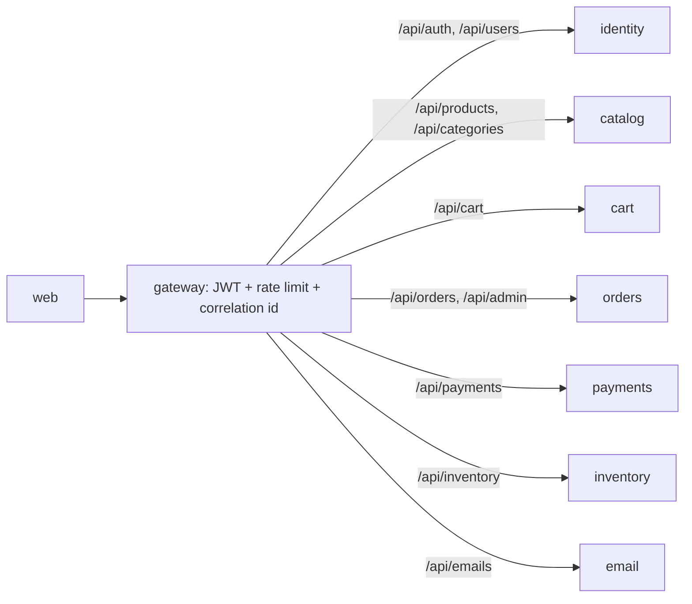
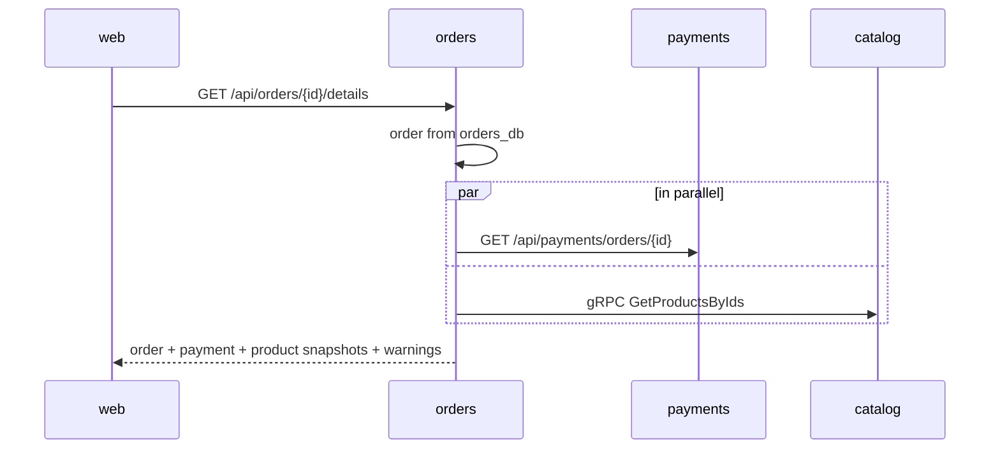
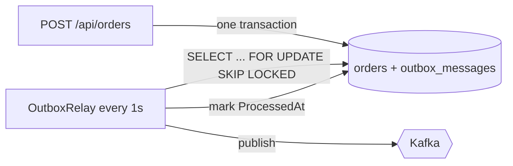
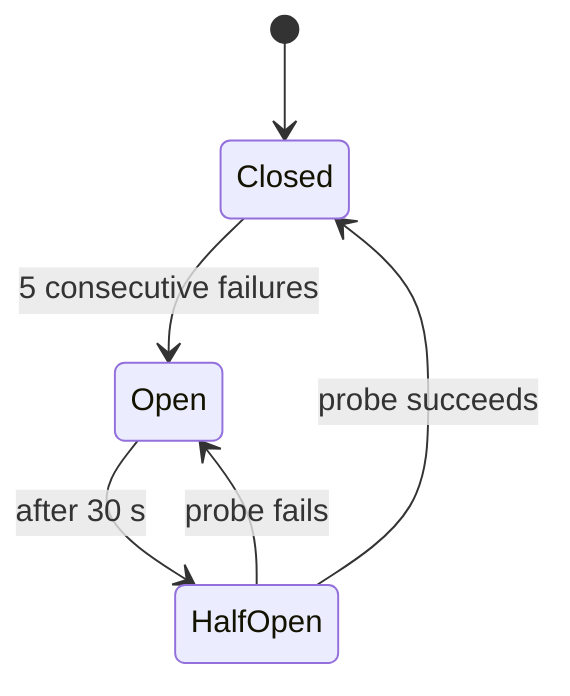
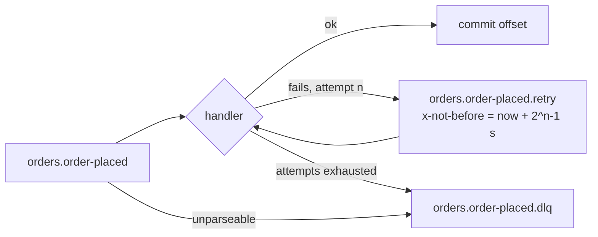

# Design patterns

Each section below is a pattern that shop-stream actually uses: the problem it solves *here*, how it
is implemented, links to the code, and what it costs.

| # | Pattern | Lives in |
|---|---|---|
| 1 | [API Gateway](#1-api-gateway) | `src/gateway` |
| 2 | [API Composition](#2-api-composition) | `orders` |
| 3 | [Database per Service](#3-database-per-service) | every service, `deploy/postgres` |
| 4 | [Choreography-based Saga with compensating transactions](#4-choreography-based-saga-with-compensating-transactions) | orders, inventory, payments |
| 5 | [Transactional Outbox](#5-transactional-outbox) | orders, payments, `shared/.../Messaging` |
| 6 | [Idempotent Consumer / Inbox](#6-idempotent-consumer--inbox) | orders, payments, inventory, cart, email |
| 7 | [Idempotency Key](#7-idempotency-key) | orders (`POST /orders`), payments (Stripe) |
| 8 | [Circuit Breaker + Retry + Timeout + Bulkhead](#8-circuit-breaker--retry--timeout--bulkhead) | orders→catalog, orders→cart, orders→payments, cart→catalog |
| 9 | [Anti-Corruption Layer](#9-anti-corruption-layer) | payments |
| 10 | [Event-Carried State Transfer](#10-event-carried-state-transfer) | catalog → cart |
| 11 | [Cache-Aside](#11-cache-aside) | catalog (and inventory availability) |
| 12 | [Retry Topic and Dead Letter Topic](#retry-topic-and-dead-letter-topic) | every Kafka consumer |
| 13 | [Health Check API, Externalized Configuration, Log Aggregation + Correlation ID](#13-health-check-api-externalized-configuration-log-aggregation--correlation-id) | every service |

---

## 1. API Gateway

**Problem.** The browser would otherwise have to know eight hosts, handle CORS for each, and every
service would need its own rate limiting.

**Implementation.** YARP is configured entirely from
[appsettings.json](../src/gateway/ShopStream.Gateway/appsettings.json) (`ReverseProxy` routes and
clusters). The gateway [Program.cs](../src/gateway/ShopStream.Gateway/Program.cs) adds:
- JWT validation, with route-level authorization policies (`authenticated`, `admin`);
- rate limiting with the .NET 7 built-in limiter ([RateLimiting.cs](../src/gateway/ShopStream.Gateway/RateLimiting.cs)): 120 requests per 10 s per IP, and a stricter sliding window on login, register and refresh;
- a correlation id for every request;
- one Swagger UI that proxies each service's OpenAPI document;
- a readiness check that pings every downstream service ([DownstreamHealthCheck.cs](../src/gateway/ShopStream.Gateway/DownstreamHealthCheck.cs)).

**Trade-offs.** It's one more hop and one more thing to deploy and scale (3 replicas in prod). It must
not grow business logic, so services still validate the JWT themselves (defence in depth).

## 2. API Composition

**Problem.** The order page wants the order, its payment and current product data. That's three
owners and three databases, and no service may query another's tables.

**Implementation.** `GET /api/orders/{id}/details` lives in
[OrderEndpoints.cs](../src/services/orders/ShopStream.Orders/Endpoints/OrderEndpoints.cs) and is
built by [OrderDetailsComposer.cs](../src/services/orders/ShopStream.Orders/Application/OrderDetailsComposer.cs):
1. It loads the order locally.
2. It starts the payments call ([PaymentsClient.cs](../src/services/orders/ShopStream.Orders/Clients/PaymentsClient.cs), REST with the caller's token) and the catalog call ([CatalogClient.cs](../src/services/orders/ShopStream.Orders/Clients/CatalogClient.cs), gRPC) **together**, then awaits both with `Task.WhenAll`.
3. It merges them into an `OrderDetailsView`.

A dependency that is down becomes a `warnings` entry instead of an error. The UI
([OrderDetailPage.tsx](../react-frontend/src/pages/OrderDetailPage.tsx)) shows the payment line, a
"now $x" price if the product changed since ordering, and the warning.

**Trade-offs.** Read-time coupling: the response is only as fast as the slowest dependency, which is
why each call has its own timeout and circuit breaker. Partial results make the client a little more
complex. The alternative, a CQRS read model fed by events, would remove the runtime calls at the cost
of eventual consistency and more code.

## 3. Database per Service

**Problem.** A shared database couples deploys and schemas, and lets one service break another's
invariants.

**Implementation.**
- Five PostgreSQL databases (`identity_db`, `catalog_db`, `orders_db`, `payments_db`, `inventory_db`), created in [init.sql](../deploy/postgres/init.sql). Each .NET service has its own `DbContext` and migrations (e.g. [OrdersDbContext.cs](../src/services/orders/ShopStream.Orders/Data/OrdersDbContext.cs)); inventory uses SQLAlchemy models ([models.py](../src/services/inventory/app/models.py)).
- Redis: cart data ([cartStore.js](../src/services/cart/src/cartStore.js)), plus separate logical databases or prefixes for caches and inboxes.
- Orders keeps its own copy of what it needs from catalog (SKU, name, unit price per order line).
- In Azure each database lives on managed Postgres ([terraform/main.tf](../deploy/terraform/main.tf)).

**Trade-offs.** No joins or ACID transactions across services. That's why the saga, outbox, inbox and
composition patterns exist. Local development runs several databases in one container for
convenience; that's an operational shortcut, not shared tables.

## 4. Choreography-based Saga with compensating transactions

**Problem.** Placing an order changes three services' data (order, stock, payment). Any of them can
fail, and there is no distributed transaction.

**Implementation.** Every service reacts to events; nothing sends commands:
- `order-placed` → inventory reserves → `stock-reserved` → payments charges → `payment-succeeded` → orders confirms → `order-confirmed`.
- **Compensations:**
  - `payment-failed` → orders cancels and publishes `order-cancelled` → inventory releases the reservation;
  - `stock-rejected` → orders cancels;
  - an expired reservation is treated like a rejection.

Code:
- [OrderSagaHandler.cs](../src/services/orders/ShopStream.Orders/Application/OrderSagaHandler.cs)
- [Order.cs](../src/services/orders/ShopStream.Orders/Domain/Order.cs), the state machine that rejects impossible transitions
- inventory's [service.py](../src/services/inventory/app/service.py) (`reserve_for_order`, `release_for_order`, `commit_for_order`, `expire_reservations`)
- [PaymentProcessor.cs](../src/services/payments/ShopStream.Payments/Application/PaymentProcessor.cs)

All diagrams and failure cases are in [order-saga.md](order-saga.md).

**Trade-offs.** No single place shows the whole flow - the docs and correlation ids have to do that.
Choreography is a good fit for three participants; with many more, an orchestrator would be easier to
reason about. Orders' state machine is already a lightweight version of that. Compensations are
semantic, not rollbacks, and refunding a payment for an order cancelled concurrently is a known gap.

## 5. Transactional Outbox

**Problem.** "Save to the database, then publish to Kafka" is two writes. A crash between them loses
the event, or publishes one for a change that was never committed.

**Implementation.**
- **Writing:** the business change and an `outbox_messages` row are saved in the **same transaction**: `db.Enqueue(...)` then `SaveChangesAsync`.
- **Relaying:** [OutboxRelay.cs](../shared/ShopStream.BuildingBlocks/Messaging/OutboxRelay.cs) polls every second, publishes unsent rows and marks them sent.
  - Rows are claimed with `FOR UPDATE SKIP LOCKED`, so several replicas don't fight over them.
  - It stops at the first failure, to keep per-order ordering.
  - It gives up on a row after 10 attempts, recording the error.
- **Shared code:** both live in [Messaging](../shared/ShopStream.BuildingBlocks/Messaging/MessagingExtensions.cs) and are used by:
  - **orders**, for order-placed, confirmed and cancelled ([PlaceOrderService.cs](../src/services/orders/ShopStream.Orders/Application/PlaceOrderService.cs));
  - **payments**, for payment-succeeded and failed ([PaymentProcessor.cs](../src/services/payments/ShopStream.Payments/Application/PaymentProcessor.cs)).

**Trade-offs.** Delivery is at-least-once (a crash after publishing but before marking the row sends
it twice), so consumers must deduplicate (pattern 6). Polling adds up to a second of latency and some
database load; change-data-capture (Debezium) would avoid polling but adds infrastructure. Inventory
and catalog publish directly after committing, which is acceptable because inventory re-answers a
redelivered event and catalog's price event is advisory.

## 6. Idempotent Consumer / Inbox

**Problem.** Kafka delivers at-least-once, and the outbox can publish twice. Handling an event twice
must have no effect - no double reservation, no double charge, no second email.

**Implementation.** Every consumer records handled event ids in `processed_events`, checking first
and writing in the same transaction as the effect where the store allows it:

| Consumer | Inbox | Code |
|---|---|---|
| orders | `processed_events` table, same `SaveChanges` as the status change | [OrderSagaHandler.cs](../src/services/orders/ShopStream.Orders/Application/OrderSagaHandler.cs), [MessagingExtensions.cs](../shared/ShopStream.BuildingBlocks/Messaging/MessagingExtensions.cs) |
| payments | `processed_events` table, same transaction as the payment and outbox rows | [PaymentProcessor.cs](../src/services/payments/ShopStream.Payments/Application/PaymentProcessor.cs) |
| inventory | `processed_events` table, added by `InventoryService._commit()` to the stock transaction | [handlers.py](../src/services/inventory/app/handlers.py), [service.py](../src/services/inventory/app/service.py) |
| cart | Redis `cart:processed_events:<id>` with a 7-day TTL (cart has no SQL database) | [inbox.js](../src/services/cart/src/inbox.js) |
| email | Redis `email:processed_events:<id>`, written only after SMTP accepted the mail | [inbox.service.ts](../src/services/email/src/inbox/inbox.service.ts) |

Domain-level idempotency backs this up: unique `order_id` on reservations and payments, and
re-applying a transition the order already made is a no-op.

**Trade-offs.** The inbox grows and needs pruning (the Redis ones expire on their own). Where the
inbox and the effect aren't in one transaction (cart, email), there is a small window in which a
crash after the effect but before the record causes one duplicate. For a cart flag that is harmless;
for email it means a rare duplicate mail rather than a lost one.

## 7. Idempotency Key

**Problem.** Clients retry: double-clicks, flaky mobile networks, a timeout on a request that
actually succeeded. A retried checkout must not create a second order, and a retried charge must not
charge twice.

**Implementation.**
- **`POST /api/orders`** accepts an `Idempotency-Key` header. The React checkout generates one per checkout page ([CheckoutPage.tsx](../react-frontend/src/pages/CheckoutPage.tsx)). `(userId, key) → orderId` is stored in `idempotency_keys`, so a repeat returns the original order with 200 instead of 201 ([PlaceOrderService.cs](../src/services/orders/ShopStream.Orders/Application/PlaceOrderService.cs)).
- **Payments** sends the **order id** as the Stripe idempotency key (`PaymentProcessor.IdempotencyKeyFor`, passed in `RequestOptions` by [StripePaymentProvider.cs](../src/services/payments/ShopStream.Payments/Providers/StripePaymentProvider.cs)). Even if our own database write failed after Stripe charged, the retry gets the same PaymentIntent back.

**Trade-offs.** Keys must be stored, and the client must reuse the same key for a real retry and a new
one for a new intent. Keys are scoped per user, so one customer can't replay another's.

## 8. Circuit Breaker + Retry + Timeout + Bulkhead

**Problem.** A slow or dead dependency should fail fast instead of tying up threads and cascading the
outage upstream. Short blips should simply be retried.

**Implementation.** Each outgoing dependency gets one stack, outermost first:
1. **Bulkhead** - at most N concurrent calls, a small queue, then reject.
2. **Retry** - exponential backoff with jitter, only for transient failures (network errors, 5xx, gRPC `Unavailable` / `DeadlineExceeded`).
3. **Circuit breaker** - opens after 5 consecutive failures for 30 s, then lets a probe through.
4. **Timeout** - per attempt.

| Call | Library | Code |
|---|---|---|
| orders → catalog (gRPC) | Polly 7.2 | `ResiliencePolicies.ForGrpc`, used by [CatalogClient.cs](../src/services/orders/ShopStream.Orders/Clients/CatalogClient.cs) |
| orders → cart, orders → payments (REST) | Polly via `AddPolicyHandler` | `ResiliencePolicies.ForHttp` in [ResiliencePolicies.cs](../src/services/orders/ShopStream.Orders/Clients/ResiliencePolicies.cs), wired in [Program.cs](../src/services/orders/ShopStream.Orders/Program.cs) |
| cart → catalog (REST) | cockatiel (Polly-style policies for Node) | [catalogClient.js](../src/services/cart/src/catalogClient.js) |

The policies are singletons, so the breaker state is shared by every call. Callers turn
`BrokenCircuitException`, `BulkheadRejectedException` and timeouts into a quick 503 problem details,
or a composition warning. Settings are in `Resilience` in orders'
[appsettings.json](../src/services/orders/ShopStream.Orders/appsettings.json).

**Trade-offs.** Retries multiply load on a struggling dependency, so they are few, backed off, and
only for idempotent reads. The numbers are guesses until measured under load. An open circuit means
customers see "try again" for up to 30 s after the dependency recovers.

## 9. Anti-Corruption Layer

**Problem.** Stripe's model (PaymentIntents, statuses like `requires_action`, `StripeException`
types) shouldn't leak into payment logic. We also need an offline stand-in.

**Implementation.**
- [IPaymentProvider.cs](../src/services/payments/ShopStream.Payments/Providers/IPaymentProvider.cs) speaks our language: `ChargeRequest` in, `ChargeResult` (succeeded, reference, reason) out.
- [StripePaymentProvider.cs](../src/services/payments/ShopStream.Payments/Providers/StripePaymentProvider.cs) is the only file that references `Stripe.*`. It translates PaymentIntent statuses and card errors into `ChargeResult`.
- [MockPaymentProvider.cs](../src/services/payments/ShopStream.Payments/Providers/MockPaymentProvider.cs) understands the same `pm_card_*` test ids.
- `AddPaymentProvider` picks Stripe for an `sk_test_` key, the mock when no key is set, and refuses anything else.

**Trade-offs.** One more abstraction. Features that only Stripe has (3-D Secure, webhooks) need the
interface extended rather than used directly.

## 10. Event-Carried State Transfer

**Problem.** Carts store the price the customer saw. When catalog changes a price, carts should know,
without every cart service instance calling catalog for every line.

**Implementation.**
- **Catalog** publishes `catalog.product-price-changed` with `productId`, `sku`, `oldPrice` and **`newPrice`** ([ProductEndpoints.cs](../src/services/catalog/ShopStream.Catalog/Endpoints/ProductEndpoints.cs)).
- **Cart** consumes it ([kafka.js](../src/services/cart/src/kafka.js)). Using only the data in the event, it marks affected lines `priceStale` with `latestPrice` (`flagPriceChange` in [cartStore.js](../src/services/cart/src/cartStore.js)). A reverse index `cart:product:<id>` finds the carts without scanning keys.
- The UI shows "now $x". Checkout still re-validates against catalog over gRPC, because the event is advisory and money always comes from the source of truth.

**Trade-offs.** The cart's copy is eventually consistent, and a lost event just means a stale flag
until checkout. Payloads grow if consumers want more fields, and the schema version matters once more
consumers depend on them.

## 11. Cache-Aside

**Problem.** Product detail pages are the most-read endpoint and the data changes rarely.

**Implementation.**
- [ProductCache.cs](../src/services/catalog/ShopStream.Catalog/Caching/ProductCache.cs): on a read, look in Redis (`catalog:product:id:<id>`, `...:slug:<slug>`). On a miss, load from Postgres and store with a 10-minute TTL. Responses carry `X-Cache: HIT|MISS`.
- [ProductEndpoints.cs](../src/services/catalog/ShopStream.Catalog/Endpoints/ProductEndpoints.cs): update and deactivate **invalidate** the id key and both the old and new slug keys.
- Redis errors fall back to the database. Without a Redis connection string an in-process cache is used ([CachingExtensions.cs](../src/services/catalog/ShopStream.Catalog/Caching/CachingExtensions.cs)).
- gRPC price lookups deliberately bypass the cache, so checkout always reads Postgres.
- Inventory's public availability endpoint uses the same idea with a 15 s TTL ([cache.py](../src/services/inventory/app/cache.py)).

**Trade-offs.**
- A write and a concurrent read can race and re-cache old data until the TTL. The short TTL bounds that.
- Invalidation lives in the write path; a new write path that forgets it serves stale data.
- Multiple keys per product (id, slug) must be invalidated together.

## Retry Topic and Dead Letter Topic

*(Pattern 12.)*

**Problem.** If a handler fails (database blip, SMTP down), retrying in place blocks the partition
and every message behind it. Some messages will never succeed.

**Implementation.** Every consumer - .NET
([KafkaConsumerService.cs](../shared/ShopStream.BuildingBlocks/Kafka/KafkaConsumerService.cs)),
Python ([kafka_io.py](../src/services/inventory/app/kafka_io.py)) and Node
([cart kafka.js](../src/services/cart/src/kafka.js),
[email kafka-consumer.service.ts](../src/services/email/src/kafka/kafka-consumer.service.ts)) -
applies the same routing ([RetryRouting.cs](../shared/ShopStream.BuildingBlocks/Kafka/RetryRouting.cs),
[retry.py](../src/services/inventory/app/retry.py), [retry.js](../src/services/cart/src/retry.js)):

- **On a handler failure:**
  - The message is copied to **`<topic>.retry`** with headers `x-retry-count`, `x-original-topic`, `x-consumer-group`, `x-error` and `x-not-before`.
  - The backoff is 1s, 2s, 4s… capped at 30 s.
  - The original offset is committed, so the partition keeps moving.
- **Reading retry topics:** each consumer also reads `<topic>.retry`. It waits until `x-not-before` and ignores copies addressed to another group - `orders.order-placed` is consumed by both inventory and email, which share one retry topic.
- **After the last attempt:** the message goes to **`<topic>.dlq`**. Unparseable (poison) messages go there immediately.

Topics are created by [create-topics.sh](../deploy/kafka/create-topics.sh). Inspect them in Kafka UI.

**Trade-offs.**
- Messages can be reordered relative to the main topic. That's fine because handlers are idempotent and state-machine guarded, and the out-of-order case in the saga relies on it.
- Waiting for `x-not-before` blocks that consumer's retry partition, which is acceptable at this scale; production systems often use tiered delay topics.
- Someone has to watch and replay the DLQs.

## 13. Health Check API, Externalized Configuration, Log Aggregation + Correlation ID

**Health Check API.** Every service exposes two endpoints:
- `/health` (liveness, no dependencies) - restarted on failure;
- `/health/ready` (readiness: Postgres, Redis, Kafka, SMTP where relevant) - taken out of rotation while failing.

Shared .NET code is in [HealthEndpoints.cs](../shared/ShopStream.BuildingBlocks/Health/HealthEndpoints.cs) and [KafkaHealthCheck.cs](../shared/ShopStream.BuildingBlocks/Health/KafkaHealthCheck.cs); Python and Node versions are in [main.py](../src/services/inventory/app/main.py), [app.js](../src/services/cart/src/app.js) and [health.controller.ts](../src/services/email/src/health/health.controller.ts). Kubernetes probes and compose healthchecks use them, and compose orders startup with `service_healthy`.

**Externalized Configuration.** Nothing environment-specific is baked into images:
- .NET reads `appsettings.json`, overridden by environment variables (`ConnectionStrings__OrdersDb`, `Kafka__BootstrapServers`, …);
- Python uses pydantic `BaseSettings` ([config.py](../src/services/inventory/app/config.py));
- Node uses `process.env` ([cart config.js](../src/services/cart/src/config.js)).

Values come from `.env` in compose ([.env.example](../.env.example)), and from a ConfigMap and a Secret in Kubernetes ([configmap.yaml](../deploy/k8s/base/configmap.yaml), [secret.template.yaml](../deploy/k8s/base/secret.template.yaml)), overridden per overlay.

**Log Aggregation + Correlation ID.**
- **Correlation id:** `X-Correlation-ID` is created at the edge (or taken from the client) by [CorrelationIdMiddleware.cs](../shared/ShopStream.BuildingBlocks/Correlation/CorrelationIdMiddleware.cs). It is forwarded on outgoing HTTP and gRPC calls, written into Kafka headers and the event envelope, and restored by every consumer.
- **Log format:** every service logs one JSON object per line with the same keys (`@t`, `@l`, `@m`, `Service`, `CorrelationId`).
- **Aggregation:** in compose, Promtail ([promtail.yml](../deploy/observability/promtail.yml)) ships all container logs to Loki and Grafana queries them. `{service=~".+"} | json | CorrelationId="..."` shows one checkout across .NET, Python and Node. On AKS, Container Insights ships the same stdout to Log Analytics ([terraform/main.tf](../deploy/terraform/main.tf)).

**Trade-offs.** Readiness checks that include dependencies can mark every pod unready during a
database blip. That's intended here, but it needs care with shared dependencies. Log aggregation
costs storage, so retention is short (30 days on Azure). The correlation id is a lightweight stand-in
for distributed tracing, without timing spans.
