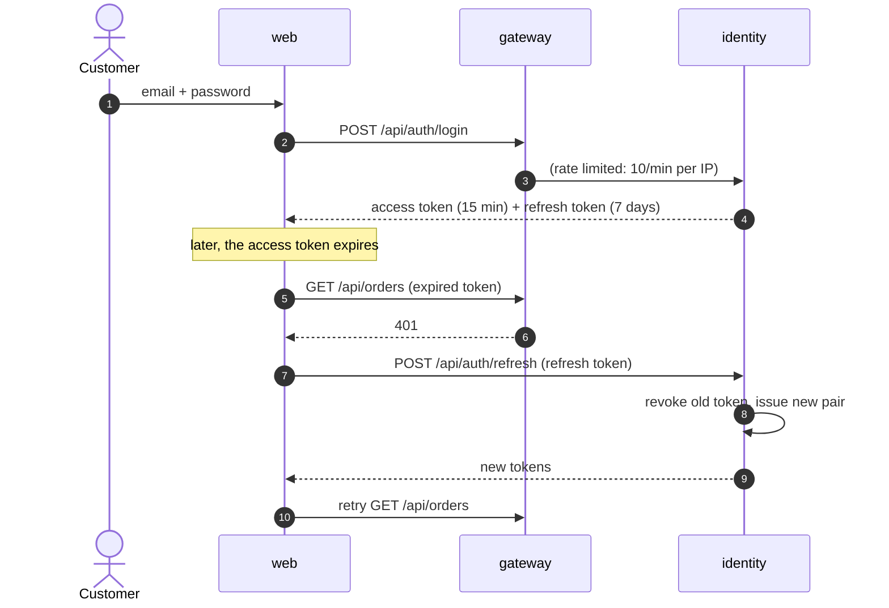
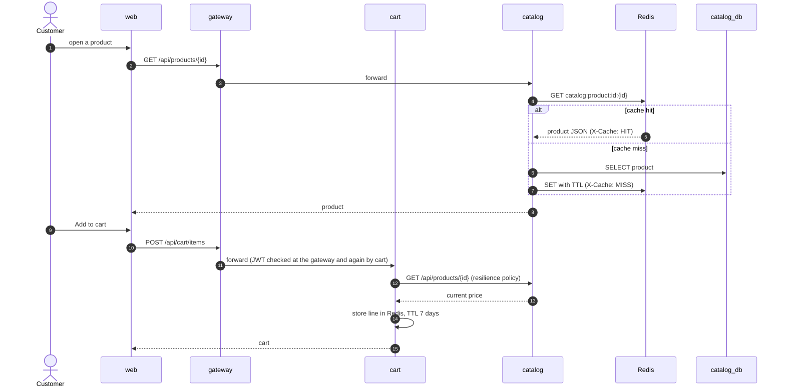
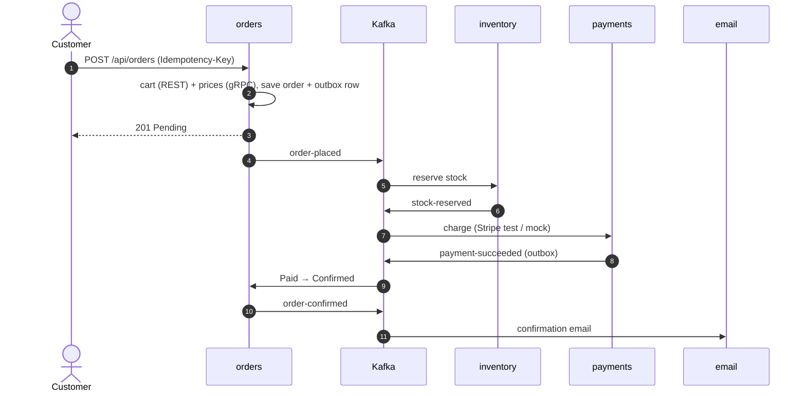
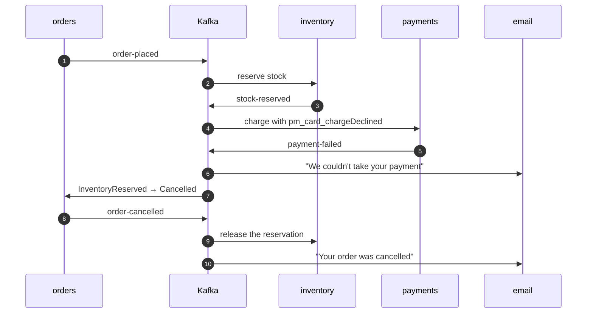
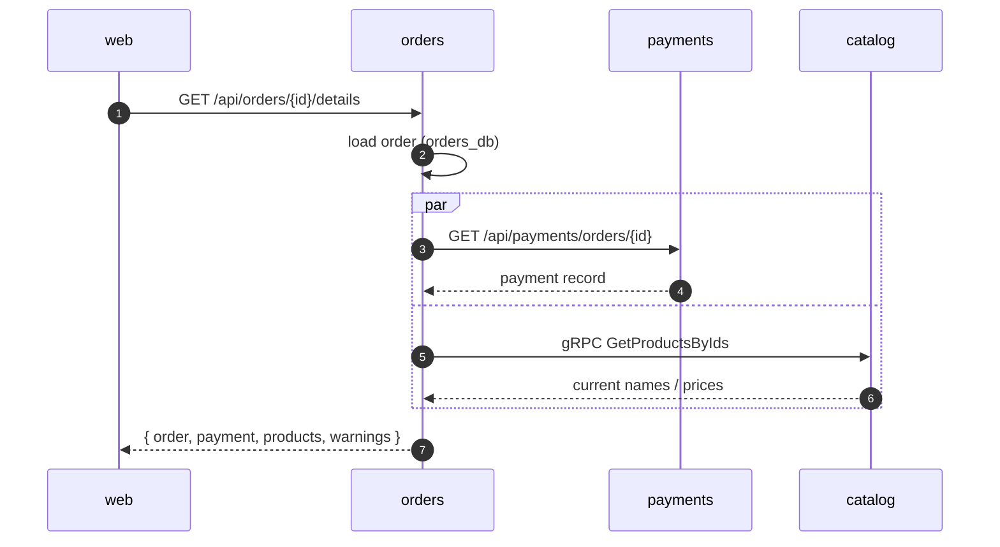
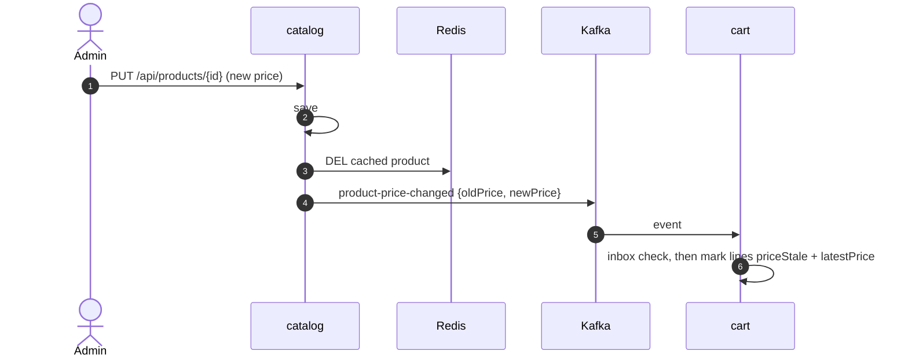
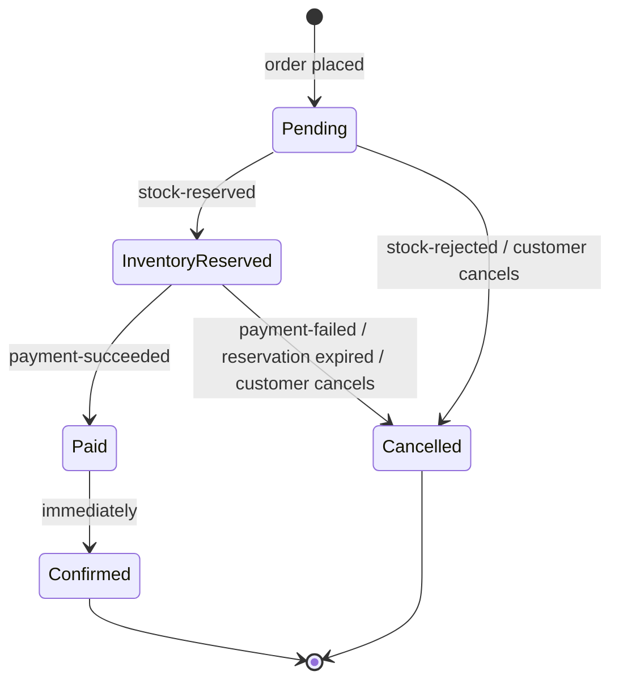
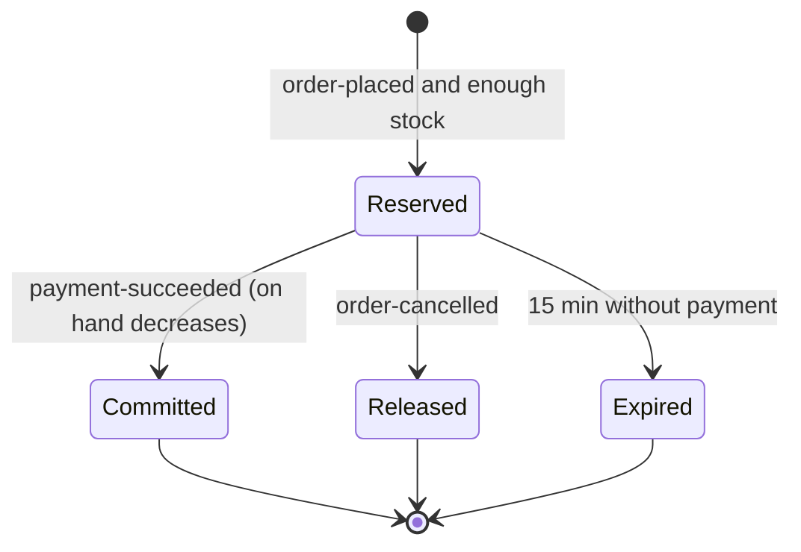
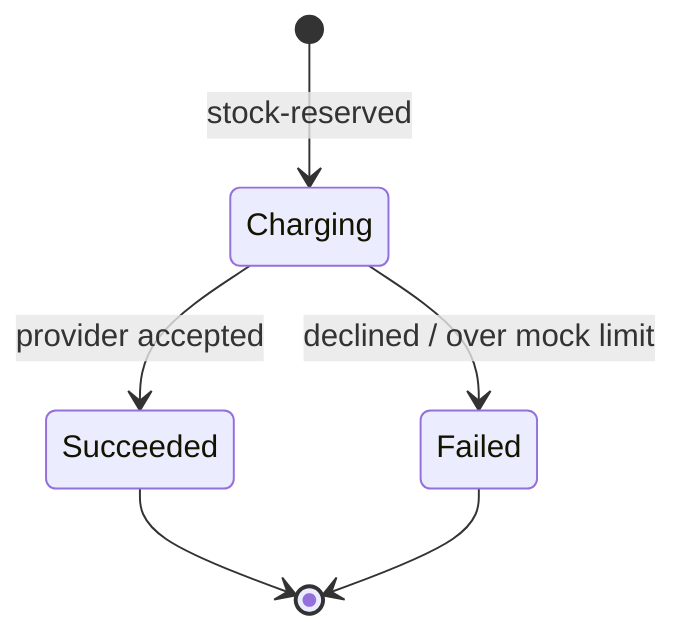

# How it works

The main user journeys, one diagram each. Checkout is summarised here; every state and failure of
the saga is covered in [order-saga.md](order-saga.md).

## 1. Sign in and stay signed in

Identity issues a 15-minute JWT and a 7-day refresh token. The React client refreshes transparently
on a 401 ([client.ts](../react-frontend/src/api/client.ts)). Refresh tokens rotate on every use, and
replaying an old one revokes the whole family.

## 2. Browse and add to cart

Product reads go through **cache-aside** in catalog (Redis, 10 min TTL). Adding to the cart makes
cart call catalog for the current price, through a bulkhead → retry → circuit breaker → timeout stack.

If catalog is down, the circuit opens after five consecutive failures. The cart then answers 503
immediately instead of waiting on timeouts.

## 3. Checkout - happy path (summary)

## 4. Checkout - payment declined (compensation)

## 5. Order details - one call, three services

The order page calls `GET /api/orders/{id}/details`. Orders loads its own order, then calls payments
(REST) and catalog (gRPC) **in parallel** and merges the answers. If either dependency fails, the
page still renders, with a warning.

## 6. A price changes

When an admin edits a price, catalog invalidates the cached product and publishes
`product-price-changed` with the **new price in the event**. Cart flags the line in every cart that
holds the product, without calling catalog back. The customer sees "now $x" in the cart, and checkout
always charges the catalog price.

## State diagrams

### Order

Enforced by the transition table in [Order.cs](../src/services/orders/ShopStream.Orders/Domain/Order.cs).

### Stock reservation

See [service.py](../src/services/inventory/app/service.py).

### Payment

There is one payment per order, enforced by a unique index on `OrderId`
([PaymentsDbContext.cs](../src/services/payments/ShopStream.Payments/Data/PaymentsDbContext.cs)).
