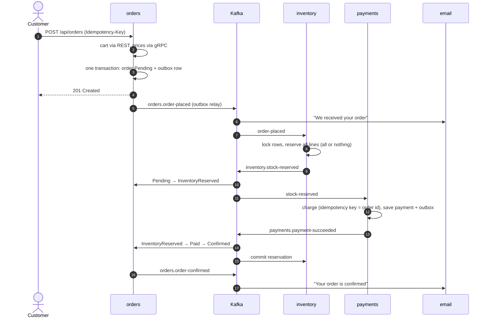
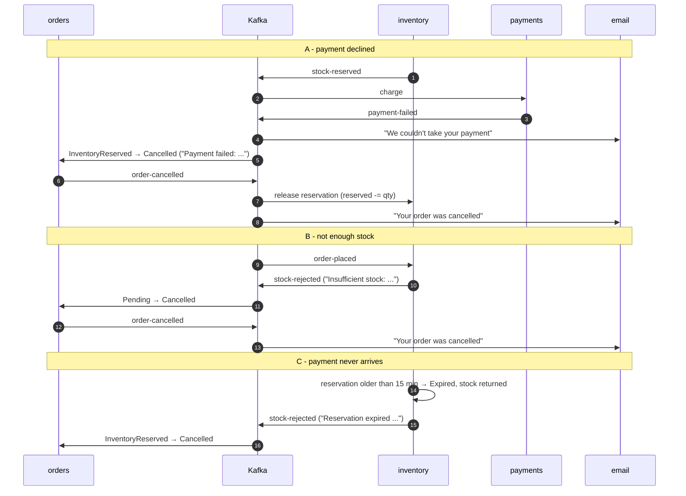

# The order saga

Checkout touches three services that each own their data: orders, inventory and payments. There is
no distributed transaction. Each step commits locally and publishes an event, the next service reacts
to it, and failures are undone by **compensating** steps. The saga is *choreographed* - no service
tells the others what to do - while orders owns the authoritative order state.

## States

| Order status | Meaning | Entered by | Can go to |
|---|---|---|---|
| `Pending` | Order saved, `order-placed` queued in the outbox | `POST /api/orders` | `InventoryReserved`, `Cancelled` |
| `InventoryReserved` | Inventory holds the stock (expires after 15 min) | `inventory.stock-reserved` | `Paid`, `Cancelled` |
| `Paid` | Payment captured | `payments.payment-succeeded` | `Confirmed` |
| `Confirmed` | Terminal - `order-confirmed` published | right after `Paid` | - |
| `Cancelled` | Terminal, with a reason | `stock-rejected`, `payment-failed`, reservation expiry, customer | - |

The allowed transitions are a table in [Order.cs](../src/services/orders/ShopStream.Orders/Domain/Order.cs).
Event handling lives in [OrderSagaHandler.cs](../src/services/orders/ShopStream.Orders/Application/OrderSagaHandler.cs).
Every transition is written to `order_status_history`, which feeds the timeline on the order page.

| Step | Local transaction | Event out | Compensation if a later step fails |
|---|---|---|---|
| orders: place | order + items + history + outbox row + idempotency key | `order-placed` | cancel the order (`order-cancelled`) |
| inventory: reserve | reservation + `reserved += qty` + inbox row | `stock-reserved` / `stock-rejected` | release the reservation |
| payments: charge | payment record + outbox row + inbox row | `payment-succeeded` / `payment-failed` | (refund - not automated, see below) |
| orders: confirm | status change + outbox row + inbox row | `order-confirmed` | - |
| inventory: commit | `on_hand -= qty`, reservation `Committed` | - | - |

## Happy path

## Compensation paths

## Failure scenarios

| Scenario | What happens | Where |
|---|---|---|
| Kafka is down when an order is placed | The order and its outbox row are committed. The relay keeps retrying and publishes once Kafka is back. | [OutboxRelay.cs](../shared/ShopStream.BuildingBlocks/Messaging/OutboxRelay.cs) |
| An event is delivered twice | Each consumer checks its `processed_events` inbox and skips the duplicate. | [InboxExtensions](../shared/ShopStream.BuildingBlocks/Messaging/MessagingExtensions.cs), [handlers.py](../src/services/inventory/app/handlers.py) |
| `payment-succeeded` arrives before `stock-reserved` | Orders throws on purpose. The message goes to `payments.payment-succeeded.retry` and is applied after the reservation. | [OrderSagaHandler.cs](../src/services/orders/ShopStream.Orders/Application/OrderSagaHandler.cs) |
| A handler keeps failing (e.g. database down) | `<topic>.retry` with 1s, 2s, 4s… backoff, then `<topic>.dlq`. | [RetryRouting.cs](../shared/ShopStream.BuildingBlocks/Kafka/RetryRouting.cs) |
| A malformed message | Straight to `<topic>.dlq`. Retrying won't fix bad data. | [KafkaConsumerService.cs](../shared/ShopStream.BuildingBlocks/Kafka/KafkaConsumerService.cs) |
| The customer double-clicks "Place order" | The same `Idempotency-Key` returns the original order (200), not a second one. | [PlaceOrderService.cs](../src/services/orders/ShopStream.Orders/Application/PlaceOrderService.cs) |
| Payments processes the same order twice | No second charge: the inbox, the unique `OrderId` index and the Stripe idempotency key (the order id) all stop it. | [PaymentProcessor.cs](../src/services/payments/ShopStream.Payments/Application/PaymentProcessor.cs) |
| Catalog or cart is down at checkout | The circuit breaker opens and the API answers 503 problem details quickly. Nothing is saved. | [ResiliencePolicies.cs](../src/services/orders/ShopStream.Orders/Clients/ResiliencePolicies.cs) |
| Late events for a cancelled order | Ignored and logged instead of dead-lettered. | `OrderSagaHandler` guards |
| Payment succeeds for an already cancelled order | Logged as "manual refund required". An automated refund saga is out of scope. | `OrderSagaHandler.HandlePaymentSucceededAsync` |

## Trigger each path locally

Start the stack (`docker compose up --build`), sign in as `customer@shopstream.local` / `Demo@12345`,
and watch the order page - it polls until the saga finishes. Kafka UI (http://localhost:8085) shows
every event; MailHog (http://localhost:8025) shows the emails.

| Path | How |
|---|---|
| Happy path | Add any in-stock product, check out with `4242 4242 4242 4242` (`pm_card_visa`). |
| Payment declined | Check out with `4000 0000 0000 0002` (`pm_card_chargeDeclined`), or `4000 0000 0000 9995` for insufficient funds. |
| Out of stock | Add a sold-out product (e.g. *Card Game: Quick Wits*), or set its stock to 0 in Admin → Inventory first. |
| Mock amount limit | With no Stripe key, an order over $5,000 is declined by the mock provider. |
| Reservation expiry | Set `RESERVATION_TTL_SECONDS=20` in `.env`, then `docker compose stop payments`, place an order and wait. Start payments again afterwards. |
| Customer cancel | Stop payments as above, then use **Cancel order** while the order is still Pending / Stock reserved. |
| Retry and DLQ | `docker compose stop postgres` while an event is in flight, then watch `<topic>.retry` and `<topic>.dlq` fill in Kafka UI. |
| Seeded history | Sign in as `jane@shopstream.local`: two confirmed orders and one cancelled after a declined card. |

Inside the Docker network every log line carries the order's `CorrelationId`. In Grafana
(http://localhost:3030 → Explore → Loki), `{service=~".+"} | json | CorrelationId="<id>"` shows one
checkout across all services.
